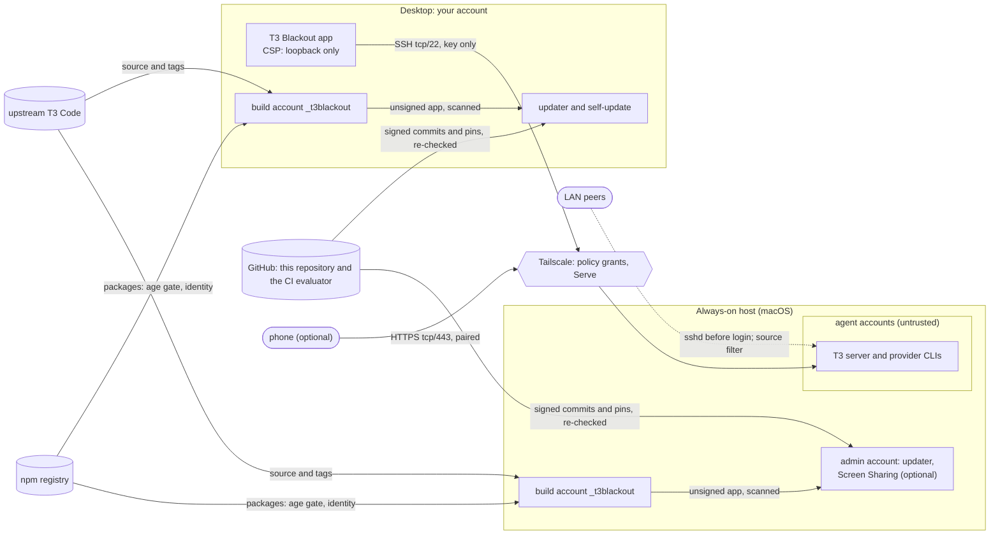

# Threat model

> **Applies to:** every role. Host-side rows are macOS-only, because only macOS has
> the host role.

This page says what T3 Blackout protects, from whom, where each control is enforced,
and which test checks it. It also lists what it deliberately doesn't protect.

## Assets

1. **Your account on each machine:** your files, your SSH key's use, your GitHub
   login, the code-signing certificate, your password manager session.
2. **Agent accounts' contents:** provider tokens, projects, threads.
3. **The integrity of what runs:** the installed app, the build that made it, and the
   update channel (this repository and `pin.json`).
4. **Privacy:** what the app reports about you and your work.
5. **Availability:** updates keep arriving; the host stays reachable; a failed update
   leaves a working app.

## Adversaries

| Adversary | Starting position |
|---|---|
| **Agent account** | runs code you don't control (an agent, a CLI, a hostile CLI update), as a standard macOS user on the host |
| **LAN peer** | on the same local network as the host or desktop; can spoof source addresses; may hold a stolen key |
| **Tailnet peer** | another device in your tailnet, or one a compromised coordination server adds |
| **Compromised evaluator** | holds the evaluator's signing key, or controls the CI `evaluate` job's output |
| **GitHub account access** | can push to the repository, but doesn't hold the owner's signing key |
| **Compromised upstream or npm** | a malicious upstream commit or tag, a hijacked npm package or publisher, a swapped tarball |
| **Lost or stolen machine** | physical possession of a powered-off or locked machine |

## Trust boundaries

Each box is a boundary. Your account trusts the build account's output only after
scanning it. An agent account trusts nothing outside itself, and nothing trusts it.
Machines trust GitHub only for transport: they verify signatures and re-derive the
evaluator's gates themselves. Dashed lines are what an adversary reaches without
passing a control first.

## Threats and controls

### From an agent account

| Threat | Control | Enforced in | Tests |
|---|---|---|---|
| Read your files or credentials | your home `go-rwx`; agent homes `0700` with no ACL but macOS's deny-delete | `install.sh`, `scripts/add-agent-account.sh` | `install.test.mjs`, `agent-accounts.test.mjs` |
| Add its own SSH key, or forward to other hosts | root-owned keys file; forwarding to this Mac's loopback only; no agent, X11 or remote forwarding | `scripts/add-agent-account.sh` | `agent-accounts.test.mjs` |
| Drive another account's server | each server requires pairing credentials, loopback included (upstream's authentication); each account's own `~/.t3blackout` and private `server.env` | upstream server authentication; `lib/files/ssh-runner-blackout.sh` for private environment handling | `ssh-runner.test.mjs` (private environment only); pairing and session authentication checked by hand against a packed server in a macOS VM |
| Stall updates by holding the build tools' lock | lock is `root:admin` 0640 plus one ACL entry for the build account, checked exactly | `install.sh`, `lib/pnpm.mjs` | `build-tools.test.mjs` |
| Tamper with the update-request folder | sticky `1733` folder in a `755` shared folder; the whole path checked, ACLs included | `lib/shared-dir.mjs` | `shared-dir.test.mjs` |
| Listen on Screen Sharing's port to fake a sign-in prompt | root jobs hold 15900 and 15901; the forward moves only to a verified holder, while parked | `scripts/enable-screen-sharing.sh` | `screen-sharing-check.test.mjs`, `screen-sharing-commands.test.mjs` |
| Change Tailscale Serve | no Tailscale rights; LocalAPI writes are root's; scripts write Serve atomically (`If-Match`) | tailscaled's LocalAPI authorization; `scripts/host-common.sh` for atomic writes | `tailscale-serve.test.mjs` (atomic writes against a fake LocalAPI); real daemon authorization checked separately in a macOS VM |
| Replace or stop the phone server's job | root-owned wrapper and plist the account can't change or unload | `scripts/add-phone-service.sh` | `phone-service.test.mjs`, `phone-server.test.mjs` |

### From the network

| Threat | Control | Enforced in | Tests |
|---|---|---|---|
| LAN peer logs in over SSH | key-only; agent accounts only (access list); logins refused unless the source is a tailnet address or loopback (`--allow-from` narrows it) | `scripts/add-agent-account.sh` | `agent-accounts.test.mjs` (Apple's sshd evaluates the drop-in) |
| LAN peer reaches Screen Sharing | loopback-only listener; Apple's every-interface job and switch kept off; refused with IP forwarding on | `scripts/enable-screen-sharing.sh` | `screen-sharing-check.test.mjs` |
| LAN peer reaches the phone server | server on `127.0.0.1`; Serve on tailnet addresses only; refused with IP forwarding on | `scripts/add-phone-service.sh`, `scripts/host-common.sh` | `phone-service.test.mjs`, `tailscale-serve.test.mjs` |
| Anyone reaches the standby lane | sshd on `127.0.0.1` and `::1` port 2222; key restricted to `from="127.0.0.1,::1"` | `scripts/add-agent-account.sh` | `agent-accounts.test.mjs` |
| Tailnet peer reaches the host | policy grants per tag, with tests; printed grants open one port each | the tailnet policy; `--print-policy` | `phone-service.test.mjs`, `screen-sharing-check.test.mjs` |
| A port published to the Internet | scripts refuse a node with Funnel on | `scripts/host-common.sh` | `tailscale-serve.test.mjs` |

### Against the update channel

| Threat | Control | Enforced in | Tests |
|---|---|---|---|
| Push unsigned or foreign-signed code | only commits signed by a key in the first parent's `.allowed_signers`; OpenPGP and X.509 refused | `lib/selfupdate.mjs` | `self-update.test.mjs`, `commit-trust.test.mjs` |
| Evaluator key signs code | evaluator commits only: one parent, `pin.json` only, forward, not a first pin | `lib/selfupdate.mjs`, `lib/pin.mjs` | `self-update.test.mjs`, `commit-trust.test.mjs` |
| Evaluator key promotes itself to owner | signers come from the first parent, never the commit itself | `lib/selfupdate.mjs` | `commit-trust.test.mjs` |
| Evaluator pins an old or unreleased commit under a release name | each tag checked against upstream with `git ls-remote` | `lib/selfupdate.mjs`, `lib/git.mjs` | `self-update.test.mjs` |
| Forged evaluation passes a bad pin | the commit job re-derives the gates without running upstream code; each machine re-derives them again | `lib/pincheck.mjs`, `lib/selfupdate.mjs` | `pipeline-pincheck.test.mjs`, `dependency-inventory.test.mjs` |
| A side branch's owner pin launders an evaluator pin | only first-parent owner commits vouch | `lib/selfupdate.mjs` | `pin-trust.test.mjs` |
| A fresh clone trusts a tampered history | verified from its first commit forward by the same rule; shallow clones refused | `lib/selfupdate.mjs` (`verifyHead`) | `commit-trust.test.mjs` |
| Git configuration redirects a fetch | global and system config ignored; HTTPS only; the clone's own config checked | `lib/git.mjs` | `git-isolation.test.mjs` |

### From upstream and npm

| Threat | Control | Enforced in | Tests |
|---|---|---|---|
| A new phone-home in upstream | host scan against `known-hosts.txt`; strict rules; forbidden-endpoint scan; tripwire smoke test | `lib/strip-engine.mjs`, `lib/rules.mjs`, `lib/smoke.mjs`, `lib/files/tripwire.cjs` | `build-strip-engine.test.mjs`, `strip-rules.test.mjs`, `build-tripwire.test.mjs`, `build-tripwire-exec.test.mjs`, `build-smoke.test.mjs` |
| A hijacked npm version | 3-day age gate; fast lane only from the usual publisher | `lib/gates.mjs`, `lib/fastlane.mjs` | `trust-supply.test.mjs`, `advisories.test.mjs` |
| A clock set ahead admits a young version | clock checked against the npm registry's `Date` | `lib/selfupdate.mjs` | `commit-trust.test.mjs` |
| A swapped tarball or non-registry source | identity is name, version, source and integrity; non-registry sources need an owner entry | `lib/lockfile.mjs`, `lib/resolution.mjs`, `lib/gates.mjs` | `dependency-identity.test.mjs`, `dependency-local-sources.test.mjs` |
| A malicious install script | scripts for five packages only; staged install guarded; builds as the build account | `lib/rules.mjs`, `lib/stage-install.mjs`, `lib/builder.mjs` | `build-artifact.test.mjs`, `build-stage-install.test.mjs`, `build-builder.test.mjs` |
| A hostile device tool | frozen reviewed closures; no install scripts; native archives by hash | `lib/device-tools.mjs`, `lib/native-assets.mjs` | `device-tools.test.mjs`, `native-assets.test.mjs` |
| A swapped pnpm (Corepack, `packageManager`) | pinned binary, checked by SHA-256 before every run | `lib/pnpm.mjs` | `pinned-pnpm.test.mjs` |
| Upstream's UI loads remote content or leaks over WebRTC | loopback-only CSP; WebRTC UDP blocked, TCP to a refusing proxy | `lib/files/t3blackoutCsp.ts`, `lib/files/boot-env.ts` | `app-webrtc.test.mjs`, `test/stripped/blackout*Csp.test.ts` |
| The app sends you to stock T3 | stock-guidance rules, and a final strict assertion | `lib/rules.mjs` | `app-stock-guidance.test.mjs` |

### Loss, and ordinary failures

| Threat | Control | Enforced in | Tests |
|---|---|---|---|
| Lost or stolen machine | FileVault; immediate screen lock; revocation playbook | setup ([base system](../install/base-system.md)), [keys and incidents](keys-and-incidents.md#a-machine-was-lost-or-stolen) | checked by hand |
| Password guessing at the FileVault SSH unlock | only the admin account can unlock the disk | setup ([host](../install/host.md#power-restarts-and-filevault)) | checked by hand (`fdesetup list`) |
| An interrupted install or rollback | journaled activation; recovery finishes or undoes it | `lib/platform/app.mjs` | `app-activation.test.mjs`, `cli-state.test.mjs` |
| Two updates at once, or a killed holder | an OS lock on the holder's own descriptor | `lib/lock.mjs` | `update-lock.test.mjs` |
| A network or source down | held or skipped, never admitted on a partial answer | `lib/selfupdate.mjs`, `lib/advisories.mjs` | `self-update.test.mjs`, `advisories.test.mjs` |
| The app installs a build nobody chose | it installs only the checked commit the app announced | `lib/expect.mjs` | `app-expected-build.test.mjs` |

## Non-goals

These are out of scope by design. Nothing in the code tries to cover them.

- **Runtime network enforcement.** T3 Blackout doesn't limit what the agents, the CLIs
  or the app reach at runtime. Sandbox the agents with your own tooling. Codex's and
  Claude Code's own sandboxes work normally. Enforcement outside this repository is
  planned.
- **Auditing upstream.** You still run upstream's code and its dependency tree. This
  removes their telemetry; it doesn't review everything else. The app runs as you.
- **Root, or your admin account, on any machine.** It has sudo, so compromising it
  compromises the machine. Root on the host can undo every host control.
- **The owner's signing key.** Whoever holds it is the owner, as far as machines can
  tell ([playbook](keys-and-incidents.md#the-owner-key-leaked)).
- **Agents within one account.** Everything running as one agent account can read
  that account's tokens and files.
- **Vendor self-updaters.** `claude update`, `codex update` and the CLIs'
  auto-updates install the vendors' newest builds, without the 3-day wait. That's
  accepted.
- **Hand-made configuration.** Unusual things the owner configures by hand: Serve
  mappings or foreground sessions on the scripts' ports, edited plists or state files.
- **Failing root filesystem operations** (`rm`, `mv`, `mktemp`, writes in `/var/db`,
  `/var/run`, `/Library`), other than a full disk.
- **A crash or power loss in a millisecond window.** The one known window is listed
  below.
- **HTTPS interception by local security software.** Not supported; remove it.

## Residual risks

These are within scope, and limited, but not closed:

| Residual | Bound | Detail |
|---|---|---|
| LAN peers reach the host's sshd before login | key-only, agent-only; source filter | a LAN peer that spoofs a tailnet address and holds an authorized key gets in. The filter checks the claimed address, not the interface ([agent accounts](../accounts/agent-accounts.md#what-the-source-filter-does-and-doesnt-do)) |
| The FileVault unlock over SSH takes a password from the LAN | unlocks the disk only, opens no session; keep `fdesetup list` to the admin account | [host](../install/host.md#power-restarts-and-filevault) |
| Screen Sharing: a crash while loading it | about 2 s of password-protected LAN reach at the next boot, measured | [Screen Sharing](../remote-access/screen-sharing.md#what-this-doesnt-protect) |
| Screen Sharing: the check polls once a minute | up to about a minute in a changed state | same |
| The phone listener, if IP forwarding is turned on later | the server still requires pairing | [phone](../remote-access/phone.md#what-this-doesnt-protect) |
| Someone who can push to `main` pushes a commit machines refuse (unsigned, or an evaluator commit breaking the shape rules) | machines keep building the pin they have and notify "self-update refused"; new updates stop until the commit is removed, which takes a force-push with the ruleset lifted | [self-update](../updates/self-update.md#limits) |
| A leaked evaluator key | at most a real, newer release that passes each machine's own gates, including any same-major Electron that moves Chromium | [self-update](../updates/self-update.md#limits) |
| The fast lane trusts npm metadata and Electron's and Node.js's release lists | other gates, the build and the smoke test still apply | [fast lane](../updates/fast-lane.md#limits) |
| The smoke test sees startup only, Node networking only | other scans and rules give additional, incomplete coverage; they don't prove the absence of outbound behaviour | [build pipeline](../building/pipeline.md#limits) |
| An install script run by absolute path inside the packager | runs as the build account; the result is refused | [dependencies](../building/dependencies.md#limits) |
| Advisory alerts: gaps for repository-only advisories, forged-but-consistent stage records, darwin native packages | each machine checks its own build | [evaluator](../updates/evaluator.md#limits) |
| Without Tailnet Lock, the coordination server could add a device | the policy still limits what it reaches | [Tailscale](../networking/tailscale.md#tailnet-lock-optional) |
| The desktop Tailscale app uploads diagnostic logs | Tailscale documents no opt-out for app variants | [Tailscale](../networking/tailscale.md#the-desktop-the-tailscale-app) |
| The stock phone app sends upstream's telemetry | only if you pair a phone | [phone](../remote-access/phone.md) |
| The app's WebRTC proxy is set 27–32 ms after start; `dns-prefetch` unmeasured | long before untrusted frames load | [privacy](privacy.md#limits) |
| Both apps register `t3code://` | with the official app installed, the system picks one | [desktop](../install/desktop.md#changing-role-or-locations) |
| Linux tested in containers only | — | [roles](../getting-started/roles.md#linux-today) |
